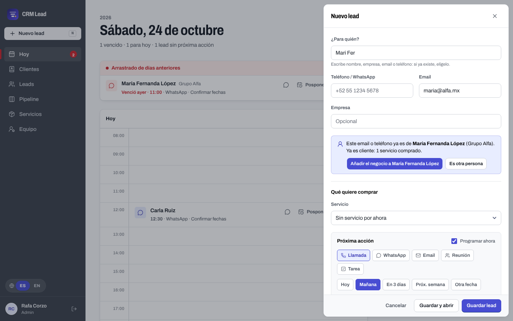
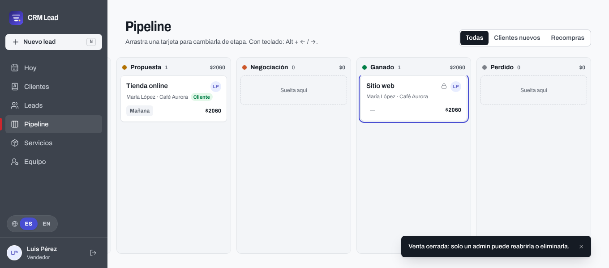
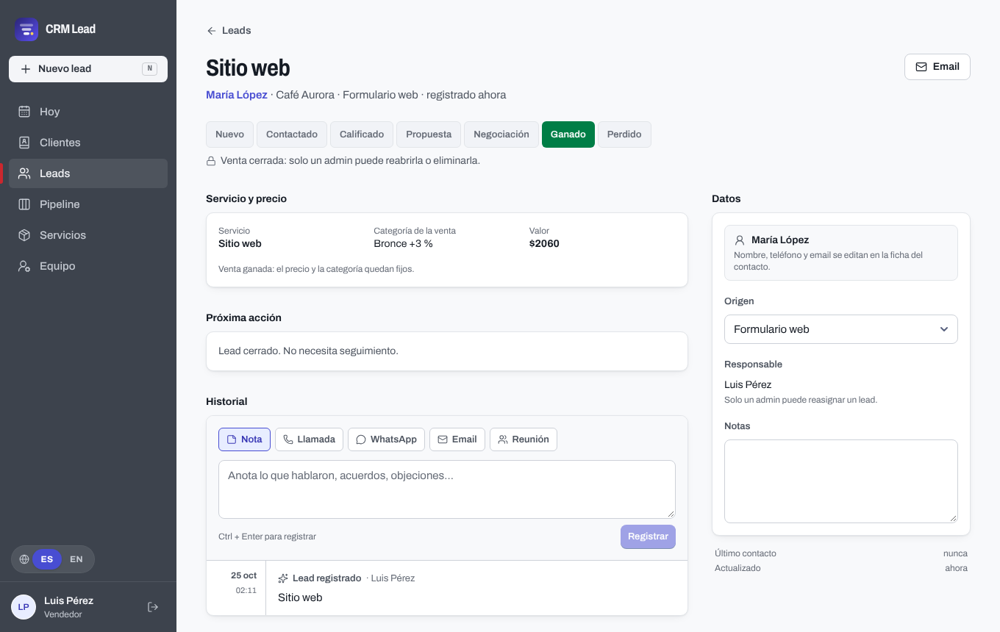
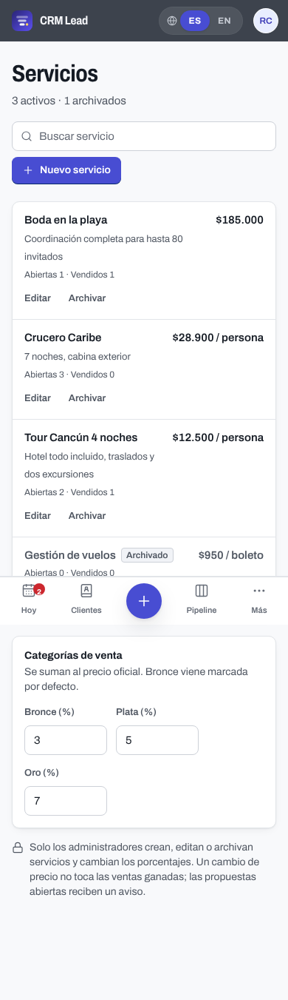

<div align="center">


# CRM Lead

**Ningún lead activo se queda sin próxima acción.**

CRM ligero para un equipo pequeño: captura leads en segundos, revisa tu día como una página de agenda
y deja cada contacto con su siguiente paso.

[](https://github.com/rcorzogutierrez/crm-lead/actions/workflows/deploy.yml)
[](https://crm-lead-follow-up.web.app)

[](https://angular.dev)
[](https://firebase.google.com)
[](https://tailwindcss.com)
[](https://www.typescriptlang.org)
[](https://vitest.dev)
[](https://nodejs.org)
[](#idiomas)
[](LICENSE)

[Funciones](#funciones) · [Stack](#stack) · [Puesta en marcha](#puesta-en-marcha) · [Pruebas](#pruebas) · [Publicar](#publicar) · [Seguridad](#acceso-y-seguridad)

<br>



</div>

---

## Funciones

### Trabajo diario

- **Hoy**, una página de agenda: lo arrastrado de días anteriores, las horas del día con la línea de "ahora",
  los próximos 7 días y los leads **sin próxima acción** marcados aparte.
- **Follow-ups** por llamada, WhatsApp, email o reunión. Completar, posponer o programar se abre en línea,
  sin modales, y completar deja historial, actualiza el último contacto y propone el siguiente paso.
- **Captura rápida** con la tecla <kbd>N</kbd>. El primer campo, "¿Para quién?", busca contactos existentes
  por nombre, empresa, email o teléfono para no duplicarlos. <kbd>/</kbd> abre la búsqueda de clientes.

### Leads, contactos y servicios

- **Pipeline** por etapas, `Nuevo → Contactado → Calificado → Propuesta → Negociación → Ganado | Perdido`,
  con arrastrar y soltar o teclado (<kbd>Alt</kbd> + <kbd>←</kbd>/<kbd>→</kbd>).
- **Ficha del lead** con etapas, próxima acción, historial de interacciones y datos editables.
- **Clientes y prospectos**: un contacto con negocios abiertos, servicios comprados e historial.
  Un contacto pasa a "cliente" con su primera venta ganada.
- **Catálogo de servicios** con precio oficial. El vendedor no escribe el precio: elige servicio, cantidad
  y categoría de venta (**Bronce +3 %** por defecto, **Plata +5 %**, **Oro +7 %**, porcentajes editables por el admin).
  Si cambia el precio oficial, las propuestas abiertas reciben un aviso y las ventas ganadas no cambian.

### Equipo

- **Roles admin y Vendedor.** Un vendedor ve y trabaja solo sus leads; el admin ve todo el equipo, reasigna,
  edita servicios y precios e invita por email. Nadie cambia su propio rol, así el equipo nunca se queda sin admin.
- **Ventas ganadas bloqueadas**: solo un admin reabre o elimina una venta cerrada.
- **Archivar contactos**: sus negocios abiertos pasan a Perdido y sus follow-ups se cancelan. Solo se borran
  contactos sin ventas ganadas.
- **Cierre por inactividad** tras 10 minutos, compartido entre pestañas, con cuenta atrás en el último minuto.
- **Registro de sesiones**: el admin ve en *Equipo* la última entrada y salida de cada miembro.

### Idiomas

Interfaz bilingüe **español / inglés**, con cambio en caliente desde el riel, la barra móvil o el login.
Fechas y montos se formatean según el idioma.

<table>
  <tr>
    <td width="50%"></td>
    <td width="50%"></td>
  </tr>
  <tr>
    <td align="center"><sub>Pipeline: la venta ganada queda fija para el vendedor</sub></td>
    <td align="center"><sub>Ficha del lead: servicio, categoría y precio pactado</sub></td>
  </tr>
</table>

<p align="center">
  <br>
  <sub>Servicios y categorías de venta, en el móvil</sub>
</p>

## Stack

| Capa | Tecnología |
|---|---|
| Interfaz | Angular 22 standalone y zoneless, signals, Signal Forms, control flow nativo |
| Datos y acceso | Firebase JS SDK 13: Auth con Google y Firestore con reglas de seguridad (sin backend propio) |
| Estilos | Tailwind CSS v4 con configuración CSS-first en `src/styles.css`, tipografía Archivo |
| Iconos | `@lucide/angular` |
| Calidad | Vitest, ESLint con angular-eslint (incluye accesibilidad) y pruebas de `firestore.rules` en el emulador |
| Publicación | Firebase Hosting con GitHub Actions |

No usa Angular Material ni `@angular/fire`: Firebase se inyecta con tokens propios (`src/app/core/firebase.ts`).

## Puesta en marcha

Requisitos: **Node 22.22.3 o superior** (lo exige Angular CLI 22) y, para las pruebas de reglas, **Java**.

```bash
npm install
npm start                # http://localhost:4200 contra Firebase en la nube
```

En la consola de Firebase, una sola vez:

1. **Authentication → Sign-in method**: habilita **Google**.
2. **Authentication → Settings → Authorized domains**: añade el dominio donde publiques la app.
3. **Firestore**: crea la base de datos y publica reglas e índices con `npm run deploy:rules`.

La **primera cuenta que entra crea el equipo y queda como admin**. Desde *Equipo* invita al resto por email;
quien entra sin invitación ve "Acceso pendiente".

### Sin tocar la nube: emuladores

```bash
npm run emulators        # terminal 1: Auth + Firestore (proyecto demo-crm-lead)
npm run start:emulator   # terminal 2: la app conectada a los emuladores
```

Con los emuladores, `window.__emulatorSignIn(email, nombre)` en la consola del navegador inicia sesión sin el popup de Google.

## Pruebas

```bash
npm run lint             # ESLint, también plantillas y accesibilidad
npm test                 # tests de la app con Vitest
npm run test:rules       # firestore.rules contra el emulador (necesita Java)
npm run build            # build de producción en dist/crm-lead/browser
```

Un cambio en `firestore.rules` va con su caso en `tests/rules/firestore.rules.test.ts`.

## Publicar

**Automático.** Cada push a `main`, por ejemplo al fusionar un PR, pasa lint, tests, pruebas de reglas y build,
y publica Hosting, reglas e índices con GitHub Actions ([`deploy.yml`](.github/workflows/deploy.yml)).
Los PR pasan las mismas comprobaciones sin publicar. Un push que solo cambia documentación
(`*.md`, `docs/`, `LICENSE`, `.claude/`, `.impeccable/`, `.vscode/`) no dispara el workflow. El workflow usa el secreto de repositorio
`FIREBASE_SERVICE_ACCOUNT`, la clave JSON de una cuenta de servicio del proyecto con los roles
*Firebase Admin* y *Service Usage Consumer*.

**Manual.** `npm run deploy` compila y publica Hosting y reglas desde tu equipo.

## Acceso y seguridad

- La configuración web de Firebase es pública por diseño; la seguridad vive en [`firestore.rules`](firestore.rules).
- Solo los miembros activos leen y escriben. Contactos y catálogo son de todo el equipo; leads, historial
  y follow-ups son de su responsable, y las reglas rechazan cualquier otra consulta de un vendedor.
- Las reglas validan precio y categoría vigentes, que una venta ganada no cambie y que nadie edite su propio rol.
- Cabeceras de seguridad en [`firebase.json`](firebase.json): `nosniff`, `frame-ancestors`, Referrer y Permissions Policy, HSTS.

## Estructura

```
src/app/
  core/        servicios, modelo de dominio, i18n, auth y guards (sin UI)
  shared/      componentes reutilizables: follow-ups, pickers, badges, selector de idioma
  features/    today · contacts · leads · lead-detail · pipeline · services · team · auth · shell
tests/rules/   pruebas de firestore.rules
```

## Documentación

- [PRODUCT.md](PRODUCT.md): para quién es y qué problema resuelve.
- [DESIGN.md](DESIGN.md): sistema visual "agenda" con la paleta Pizarra.
- [CLAUDE.md](CLAUDE.md): modelo de datos, reglas de dominio y convenciones del código.

## Licencia

[MIT](LICENSE) © 2026 Rafa Corzo
